# MVP acceptance test, 17 October 2026

Acceptance run of the Nemu MVP software part (#1) on `main` at `3fafdb0`, after #2–#14 merged.
The done condition from #1: the three Momen run in order, without developer help, three times in
a row.

## Verdict

| Responder                          | Momen 1 | Momen 2 | Momen 3            | Done condition |
| ---------------------------------- | ------- | ------- | ------------------ | -------------- |
| Fixture (`NEMU_RESPONDER=fixture`) | 30/30   | 6/6     | 4/6 passes clean ¹ | **Met**        |
| Real AI (`NEMU_RESPONDER=ai`)      | 0/3     | 3/3 ²   | 0/3                | **Not met**    |

¹ Each pass runs Momen 3 five times. In 2 of the 6 passes, the test pressed Kirim before the
upload refetch finished (finding 5), which stopped that pass. The extension wasn't at fault. ² Answered and highlighted correctly, but the card covers one target and the
text is wrong about auto-fill (findings 3 and 4).

The extension, Demo App and Nemu Service do what the Momen need: with the fixture Responder, the
whole demo works. The AI pipeline doesn't yet give the answers the demo depends on: Momen 1
asks a question instead of opening the form, and Momen 3 leaves out one upload and the Kirim
confirmation.

## How it was run

- Local dev stack (`pnpm dev`): Nemu Service on :3000, Demo App on :3001, extension dev build
  loaded unpacked into Playwright's Chromium at 1280×800, signed in as Rina, demo clock
  6 November 2026.
- **Fixture:** `pnpm --filter extension verify`, six times in a row. Each pass runs Momen 1 five
  times, Momen 2 once and Momen 3 five times, plus the allowlist, signed-out, citation and mascot
  checks.
- **Real AI:** [`ai-acceptance.mjs`](ai-acceptance.mjs), three rounds of Momen 1 → 2 → 3 with a
  demo data reset before each round. It drives the page the same way `verify` does, but checks
  the outcome the demo needs (the click, highlight targets, Rp447.000, the deadline, Kirim →
  Verifikasi) instead of the fixtures' exact wording. It reads the actions and durations from the
  Chat Log. Run it with
  `node docs/acceptance/2026-10-17/ai-acceptance.mjs . <out-dir> 3` while `NEMU_RESPONDER=ai pnpm dev` is up.

## Findings

Ordered by risk to the demo.

### 1. Real AI: Momen 1 asks a question instead of opening the form (blocker)

3 out of 3 rounds, the AI answered `clarify`: "Bu Rina, proses aktif PD-2026-0042 sudah berada
pada tahap Pertanggungjawaban. Apakah rapat ke Makassar ini perjalanan baru atau perjalanan
yang sama?". There was no `click` action, so the form never opens.

Cause: since #4, `nemuChat` sends the server-loaded process context, and the demo data always
has PD-2026-0042 (the Makassar trip) in Pertanggungjawaban. That's the state Momen 3 needs. In
Momen 1, the AI sees an active Makassar trip and reasonably asks whether this is a new one.

Options: have the AI treat "dapat tugas … mulai dari mana" as a new trip (Zahra), or give
Momen 1 its own demo data scene with no active process (Demo App panel). The **Jawab** button
was not tested, so it's unknown whether answering "perjalanan baru" then leads to the click.

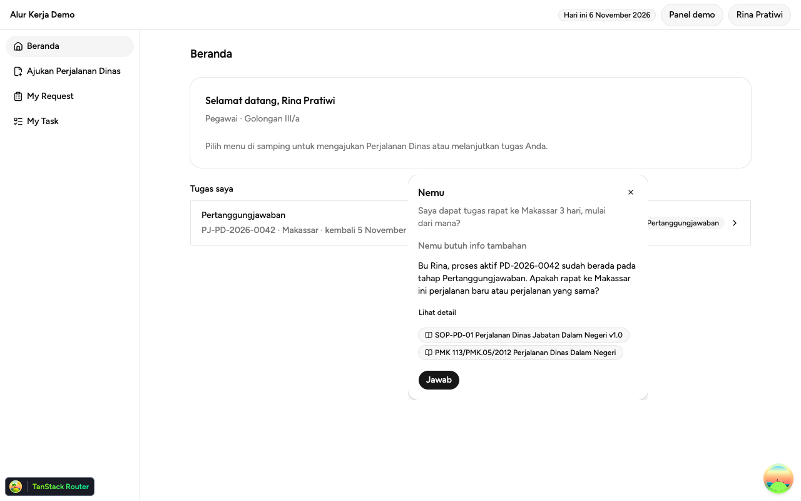

### 2. Real AI: Momen 3 follow-up highlights one upload and doesn't confirm Kirim (blocker)

The first request opens the task correctly (3/3). On the task page, the follow-up answer's text
names both missing documents and the 12 November 2026 deadline. Its actions, however, were only
`highlight:upload-boarding-pass-pulang` in all three rounds. Two actions are missing:

- the `highlight` on `upload-laporan-perjalanan`
- the `confirm` on `button-kirim`

Without the `confirm`, Kirim gets no "Kamu yang mengirim" ring, and the extension doesn't watch
the State. The Demo App does move to Verifikasi when Rina presses Kirim, but the Answer Card
never shows Terkirim / PJ-PD-2026-0042 / Verifikasi.

| Real AI                                                                     | Fixture (expected)                                                                             |
| --------------------------------------------------------------------------- | ---------------------------------------------------------------------------------------------- |
| 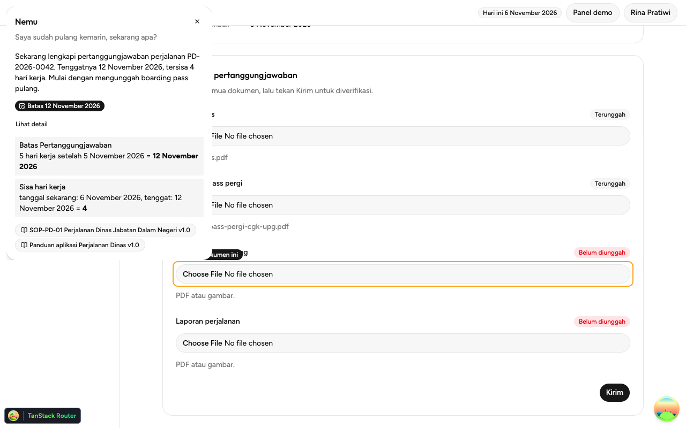             | 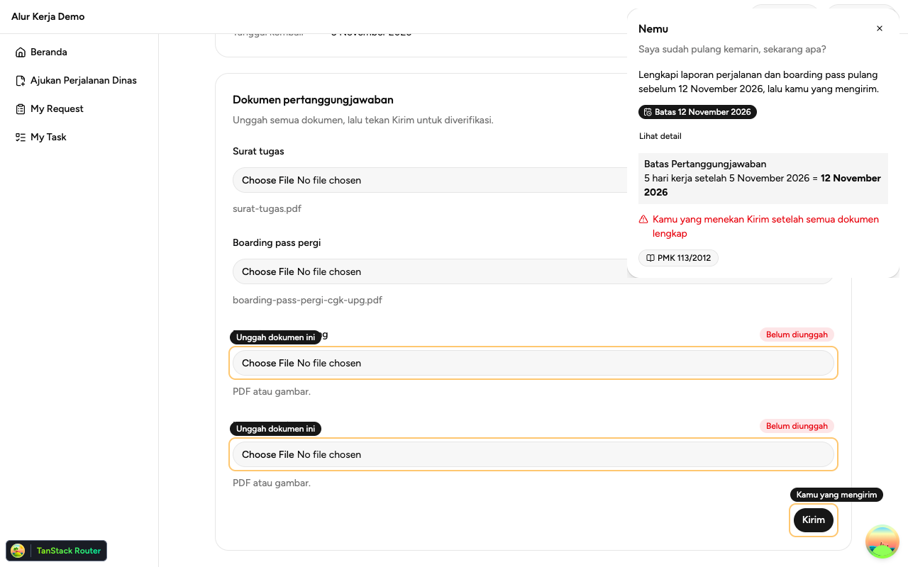       |
| 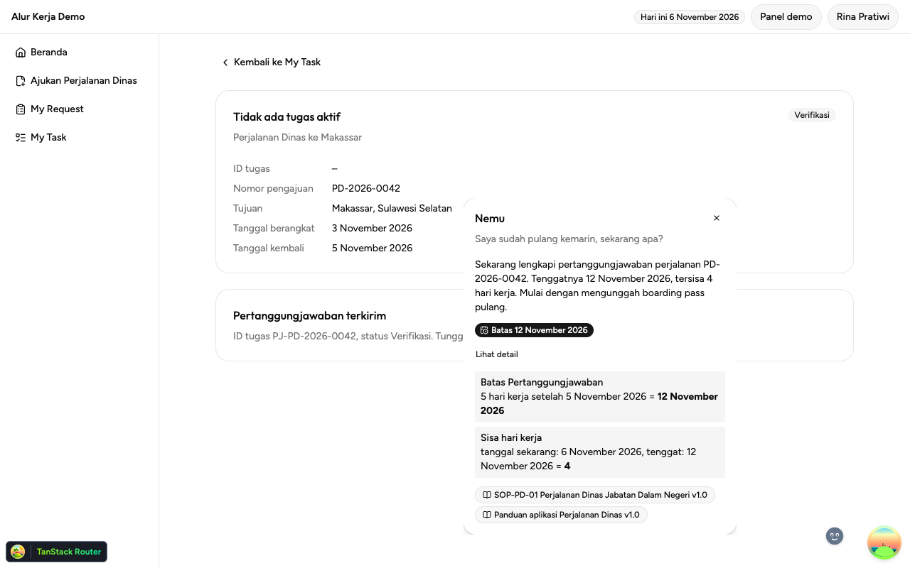 | 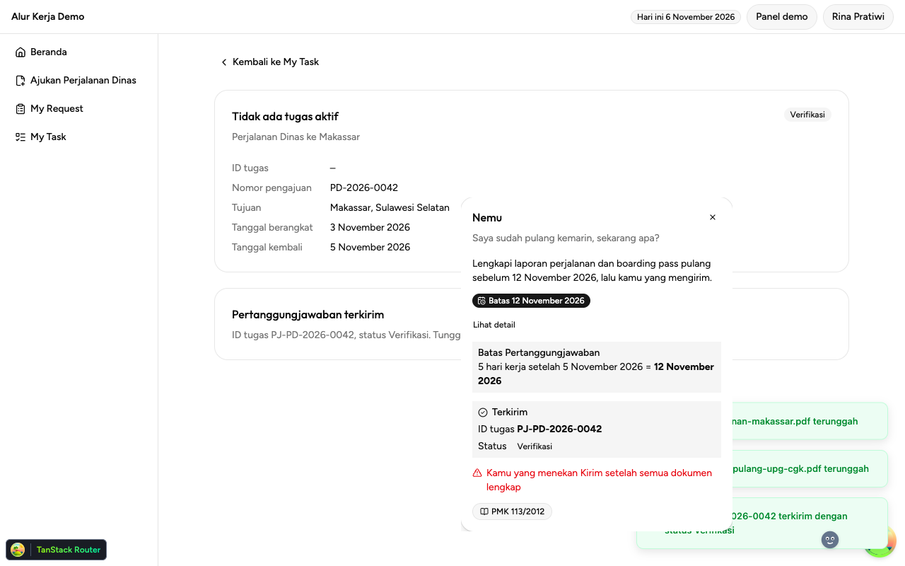 |

### 3. Momen 2: the Answer Card covers the "Tidak menginap di hotel" option (major)

The AI's Momen 2 answer carries three calculation rows, so its card is taller than the fixture's.
It lands on the left of the page, over the radio button and its "Pilih ini" ring. Only the
"Isi nominal ini" ring stays visible. The fixture card is placed on the right and keeps off both
targets (the `verify` check). Card placement needs to keep away from every target whatever the
card's height.

| Real AI                                                                   | Fixture                                                                          |
| ------------------------------------------------------------------------- | -------------------------------------------------------------------------------- |
| 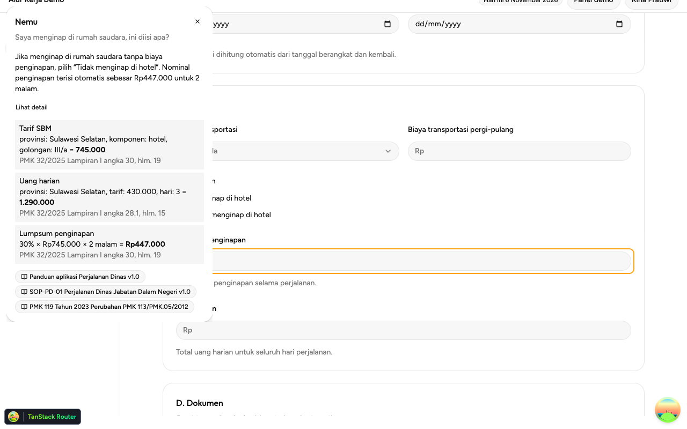 | 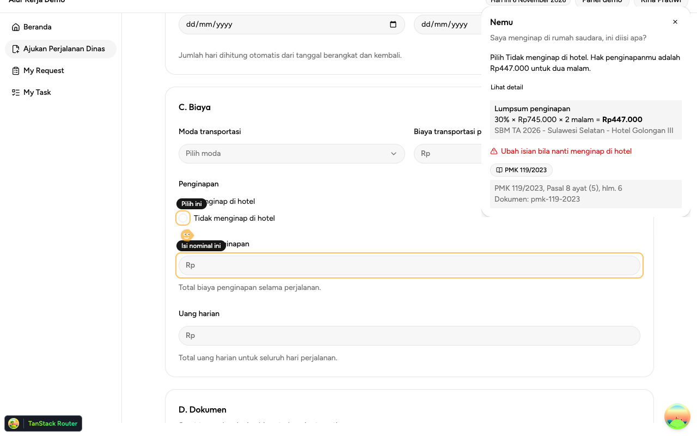 |

### 4. Real AI: Momen 2 says the lodging amount fills in automatically (major)

All three rounds said "Nominal penginapan terisi otomatis sebesar Rp447.000 untuk 2 malam". The
Demo App doesn't auto-fill that field: Rina types the amount herself (`biaya-section.tsx`). The
amount itself, the highlights, the Area Crop and the Arahkan-only behaviour were all correct in
3/3 rounds. The answer cites "PMK 119 Tahun 2023 Perubahan PMK 113/PMK.05/2012", but not the
Pasal 8 ayat (5) reference the fixture shows.

### 5. Kirim can be refused right after an upload (minor, flaky test)

`usePertanggungjawaban.kirim()` checks the cached Process Instance, which refreshes only after the
"terunggah" toast. Pressing Kirim inside that gap shows "Unggah dulu: Boarding pass pulang" even
though the upload succeeded. `verify` waits only for the toast, so it hit this in 2 of 6 passes.
A person choosing two files by hand is far slower than the refetch, so the demo is unlikely to
hit it. The fix is either to have `verify` wait for the "Terunggah" badge, or to have Kirim
disable itself while the refetch is pending.

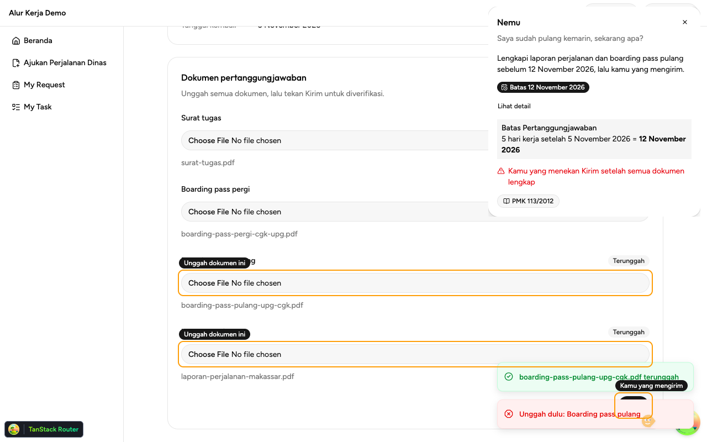

### 6. Toasts cover the Kirim button and its ring (minor)

The two "terunggah" toasts stack bottom right, on top of Kirim and the "Kamu yang mengirim"
label, for about four seconds after the uploads (visible in the screenshot above). On stage,
that hides the very button Nemu points at.

### 7. Real AI latency is 6–7 s per answer (note)

| Momen                       | Server duration (3 rounds) | Average |
| --------------------------- | -------------------------- | ------- |
| 1                           | 6.8 s, 7.0 s, 6.6 s        | 6.8 s   |
| 2                           | 5.2 s, 7.4 s, 6.0 s        | 6.2 s   |
| 3, first request            | 6.7 s, 7.4 s, 6.1 s        | 6.8 s   |
| 3, follow-up                | 6.9 s, 7.2 s, 7.2 s        | 7.1 s   |
| 3, prompt to follow-up card | 15.0 s, 16.3 s, 14.5 s     | 15.3 s  |

The "membaca…" status within 1 second, from the #15 backlog, matters more with these times.

## Fixture walkthrough

The demo as it should look, from the fixture run.

|                                                                                                                                                                          |                                                                                                                                                   |
| ------------------------------------------------------------------------------------------------------------------------------------------------------------------------ | ------------------------------------------------------------------------------------------------------------------------------------------------- |
| 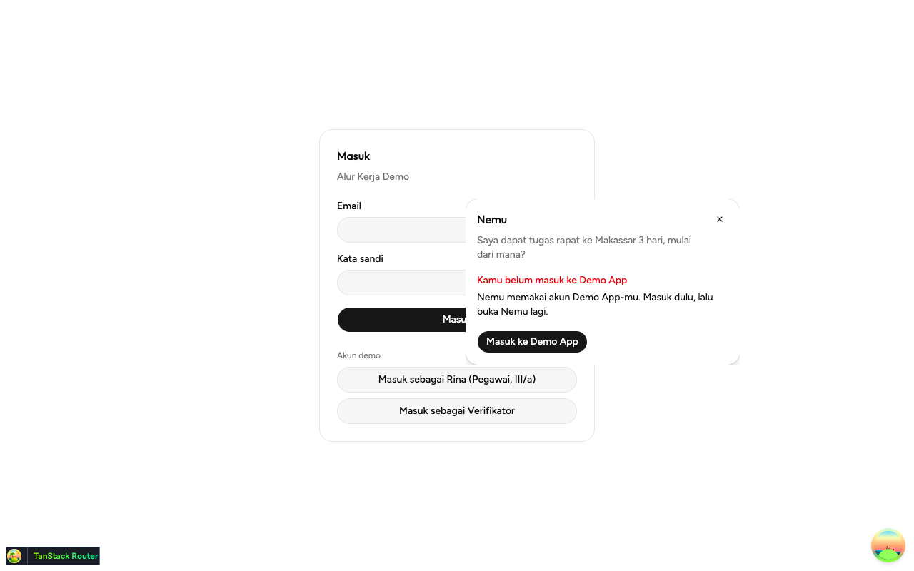 Signed out, the card asks Rina to log in.                                                            | 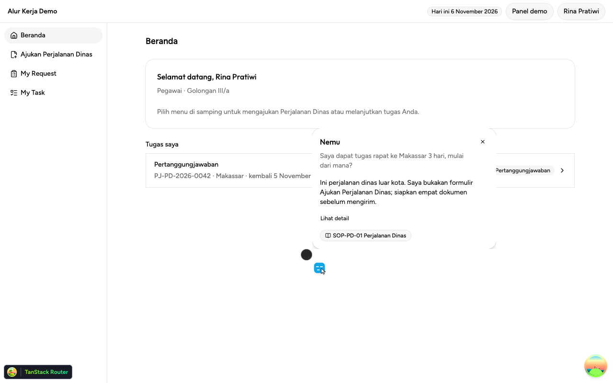 Signed in, the Momen 1 answer with its citation.                                            |
| 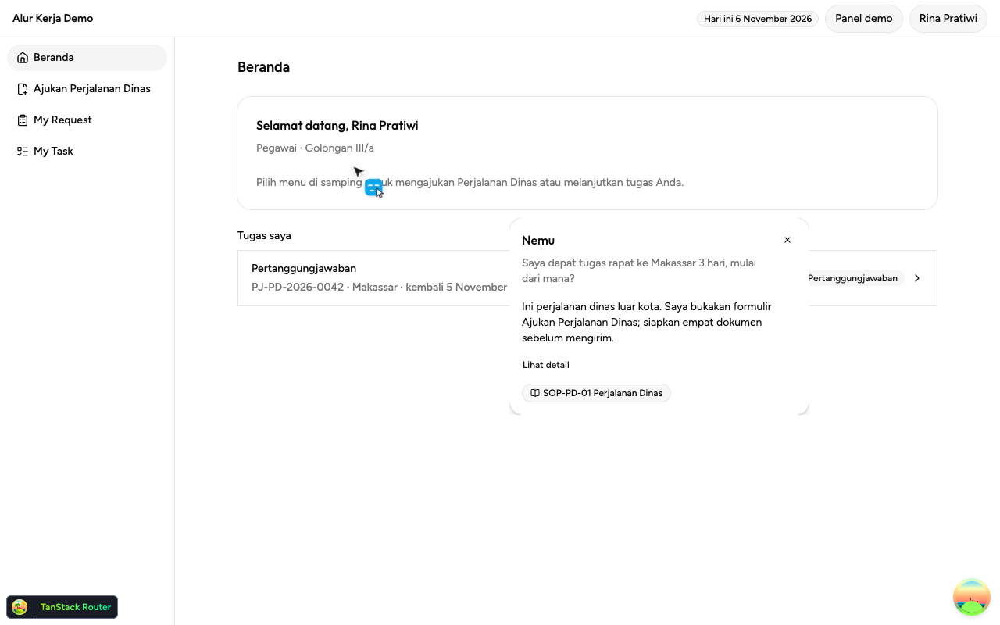 Momen 1: Nemu's cursor heads for Ajukan Perjalanan Dinas.                                 | 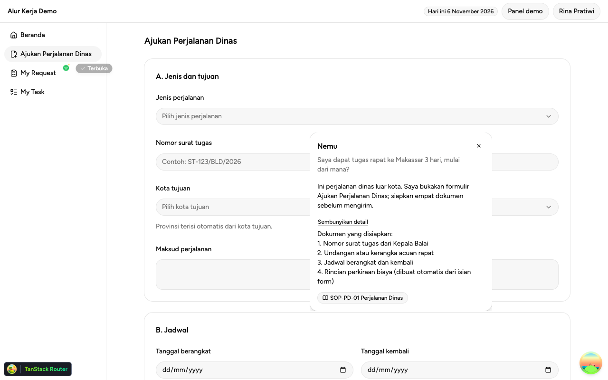 The form opens, with the four documents to prepare.            |
| 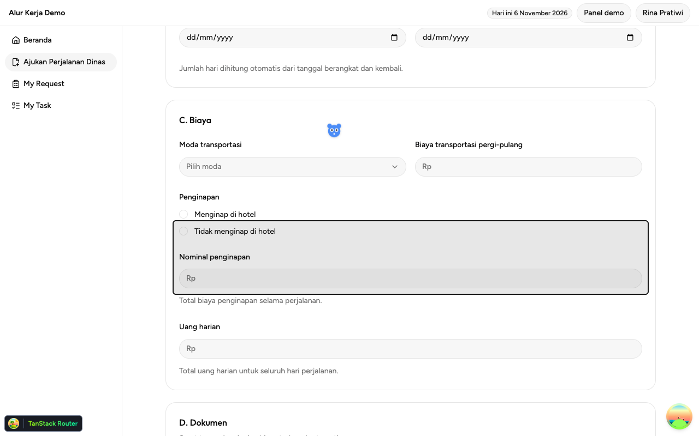 Momen 2: Rina drags a box over the lodging fields.                                   | 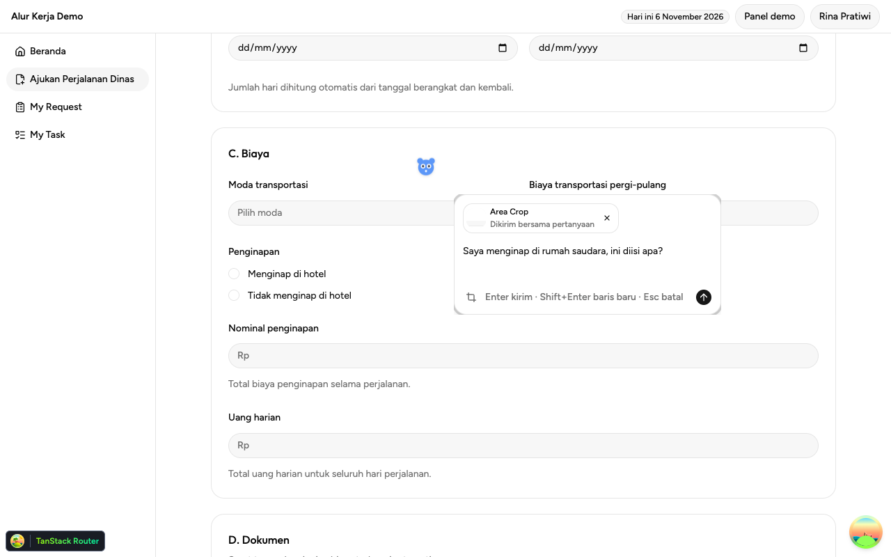 Only that area goes with the prompt.                           |
|  Both fields ringed, 30% × Rp745.000 × 2 malam = Rp447.000.                              | 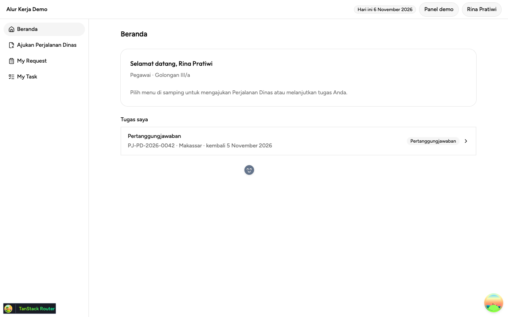 The mascot follows the cursor.                                                           |
|  Momen 3: the task opens, the two uploads and Kirim are ringed, Batas 12 November 2026. |  Rina presses Kirim, and the card shows PJ-PD-2026-0042 in Verifikasi. |

The Area Crop actually sent with the Momen 2 prompt:

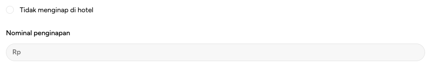

## Not covered

- Ctrl+Shift+Space and the toolbar icon. Automation can't press them, so both runs opened the
  Composer through the background's message.
- The deployed apps (`*.ahargunyllib.dev`) and a production extension build. Everything ran on
  the local dev stack, which is why the TanStack Router devtools badge shows bottom left.
- The Admin Workspace pages (knowledge upload, SBM and holiday tables, Chat Log). They were only
  exercised through `listChatLog`.
