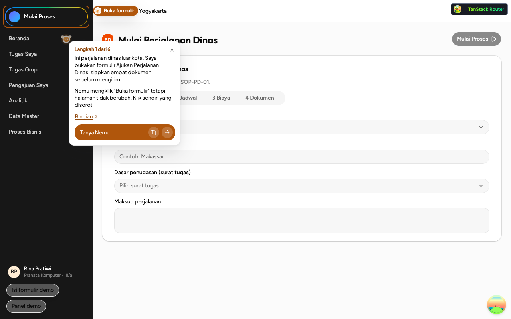
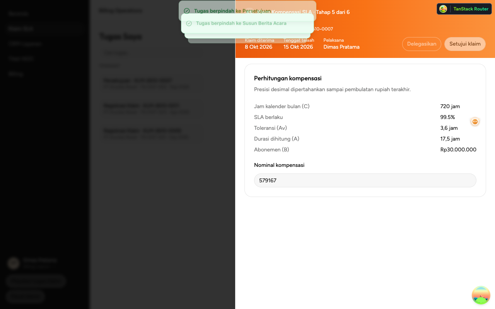
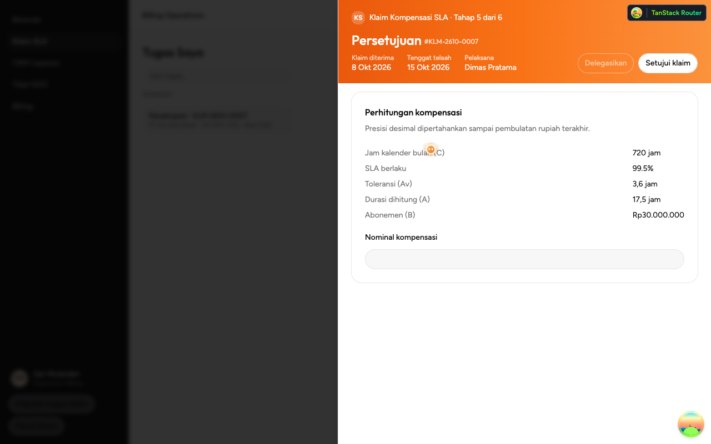
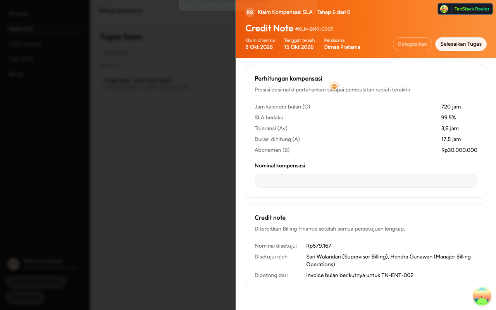
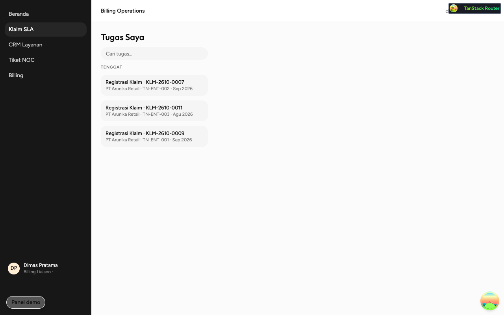
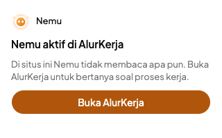

# Fixture acceptance run, 29 October 2026

Acceptance run on `main` at `f95e552`, after Klaim SLA approval through to Credit Note (#178,
closes #146) merged. It repeats the fixture half of the
[17 October run](../2026-10-17/README.md) on the checks `verify` has gained since, including
the Telco workspace (Dimas, Sari and Hendra).

## Verdict

| Pass | Exit | Duration | Result                                          |
| ---- | ---- | -------- | ----------------------------------------------- |
| 1    | 0    | 59 s     | 13/13 checks                                    |
| 2    | 1    | 63 s     | 12/13: one of the five Momen 1 runs (finding 1) |
| 3    | 0    | 57 s     | 13/13 checks                                    |
| 4    | 0    | 58 s     | 13/13 checks                                    |
| 5    | 0    | 57 s     | 13/13 checks                                    |
| 6    | 0    | 57 s     | 13/13 checks                                    |

| Check                                                 | Passed |
| ----------------------------------------------------- | ------ |
| Momen 1, from Beranda to the form and its follow-up   | 29/30  |
| Momen 2, Area Crop, rings, Isi and mismatch           | 6/6    |
| Momen 3, from Beranda to Verifikasi                   | 30/30  |
| Klaim SLA branches as Dimas (#140)                    | 6/6    |
| Sari, then Hendra, approve to Credit Note; demo reset | 6/6    |
| Allowlist, toolbar popup, signed out, mascot, crops   | 6/6    |

With the fixture Responder the demo works, and the new approval route works every time: Sari
approves, Hendra approves, KLM-2610-0007 reaches Credit Note with Rp579.167, and Reset data demo
puts all three claims back at Registrasi Klaim. The one failure is in the extension, not the
Demo App or the Nemu Service: once in 30 runs, Nemu's click opened the form but Nemu reported
that the page hadn't changed.

## How it was run

- Local dev stack in fixture mode (`.claude/launch.json` `dev-fixture`, i.e.
  `NEMU_RESPONDER=fixture pnpm dev`): Nemu Service on :3000, Demo App on :3001, local D1.
- `pnpm --filter extension verify`, six times in a row. Each pass builds the extension for
  production, loads it into Playwright's Chromium at 1280×800, and opens the Composer through
  the toolbar icon (CDP `Extensions.triggerAction`). It runs Momen 1 five times, Momen 2 once,
  Momen 3 five times, the Klaim SLA checks as Dimas, then the Sari → Hendra approval and the
  demo reset. The full list is in `apps/extension/README.md`, "Check it in a real browser".

## Findings

### 1. Momen 1: Nemu reports "halaman tidak berubah" after a click that opened the form (minor, flaky)

In pass 2, one of the five Momen 1 runs stopped after Nemu's click. The page had moved to
`/perdin/baru` and the form was on screen, but the card said "Nemu mengklik "Buka formulir"
tetapi halaman tidak berubah. Klik sendiri yang disorot." and rang the Mulai Proses pill.
The follow-up after a click (`useClickFollowUp`) waits for a click that counts as succeeded, so
the follow-up answer on the form never came and `verify` timed out waiting for it.

The decision comes from `waitForChange` in
`apps/extension/features/navigation-click/lib/navigation-click.ts`. It looks for a URL change, the
clicked target disappearing, or a new `data-nemu-id`, for `CHECK_TIMEOUT_MS` (2 s) after the
click. Not diagnosed further. A likely cause is that, on the Vite dev server, the router took
more than 2 s to commit the navigation to the form route. If so, a demo on the deployed build
would hit it less, but a slow laptop on stage could still hit it. On stage, Rina would see the
form open and Nemu claim it didn't, then have to ask again.

### 2. Approvers see an empty Nominal kompensasi (minor)

On Persetujuan, Sari and Hendra see the calculation but an empty **Nominal kompensasi** field.
The amount Dimas entered on Susun Berita Acara is held only in his page's state
(`sla-claim-task.tsx`), so the approvers never see it. The amount they approve, Rp579.167,
first appears on the Credit Note card after the last approval.

| Dimas on Persetujuan, still in his session                                           | Sari on Persetujuan                                                              |
| ------------------------------------------------------------------------------------ | -------------------------------------------------------------------------------- |
|  |  |

### 3. Persetujuan names Dimas as Pelaksana (note)

The task header on Persetujuan and Credit Note says "Pelaksana: Dimas Pratama" while Sari or
Hendra is the one acting. It is the claim's Billing Liaison, so it may be intended, but the
header doesn't say whose approval is due.

## Klaim SLA approval walkthrough

|                                                                                                                                         |                                                                                                                                                   |
| --------------------------------------------------------------------------------------------------------------------------------------- | ------------------------------------------------------------------------------------------------------------------------------------------------- |
|  Dimas drafted the claim, so Setujui klaim stays disabled for him.  |  Signed in as Sari, Setujui klaim is enabled on her turn.                              |
|  After Hendra approves: Credit Note, Rp579.167, both names. |  Reset data demo as Dimas puts all three claims back at Registrasi Klaim. |

The toolbar icon on a site outside the allowlist shows the popup with Buka AlurKerja (#173):

## Not covered

- The real AI Responder. This run is fixture-only; the AI round from 17 October was not repeated.
- What Selesaikan Tugas does on the Credit Note stage, and the approval of a claim at or under
  Rp500.000 (Sari alone). `verify` stops at Credit Note and only approves KLM-2610-0007.
- Ctrl+Shift+Space. Automation can't press it; the toolbar icon was pressed through CDP.
- The deployed apps (`*.ahargunyllib.dev`). Everything ran on the local dev stack, which is why
  the TanStack Router devtools badge shows top right.
- The Admin Workspace pages.
