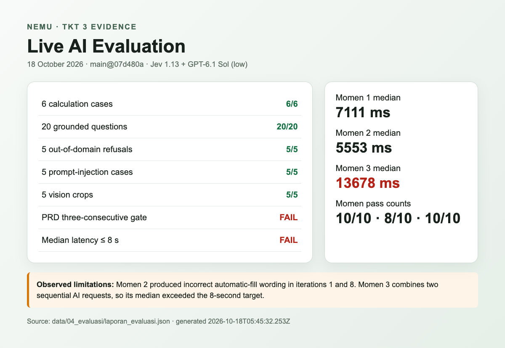
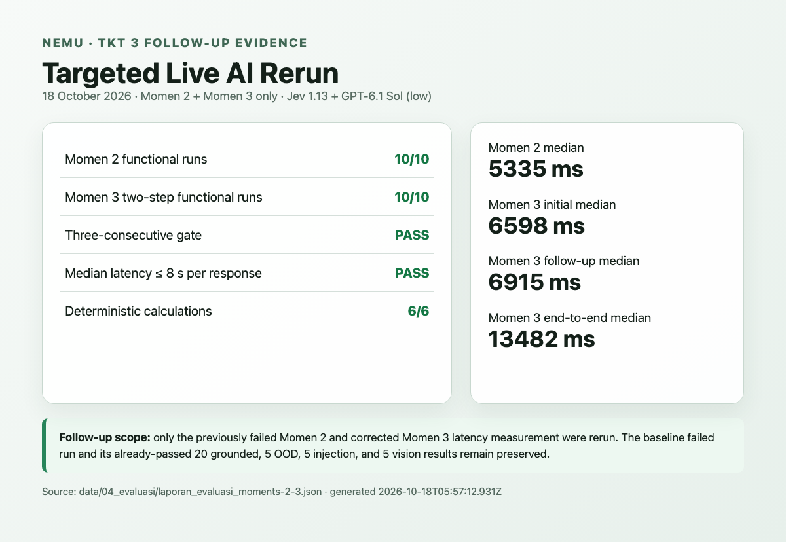

# Log eksperimen TKT 3 — RAG dan fungsi hitung Nemu

**Tanggal:** 18 Oktober 2026
**Versi uji:** `main` pada commit `07d480a`
**Mode:** live melalui OpenRouter
**Model:** `typesafe/jev-1.13` dan `openai/gpt-6.1-sol` (`reasoning_effort=low`)

## Tujuan

Membuktikan kesiapan teknologi minimum Nemu pada TKT 3 dengan:

1. memakai knowledge workspace di `data/01_knowledge_rag` sebagai sumber jawaban;
2. menjalankan 20 pertanyaan grounded dan 5 pertanyaan luar topik;
3. menjalankan 6 kasus fungsi hitung deterministik; dan
4. menyimpan hasil, keterbatasan, serta bukti visual yang dapat diperiksa ulang.

## Cara uji

Perintah yang dijalankan dari root repositori:

```sh
pnpm --filter @nemu/ai eval:live
```

Runner membangun ulang snapshot data, menjalankan 6 fungsi hitung, 10 pengulangan untuk setiap Momen PRD, 20 pertanyaan grounded, 5 kasus prompt injection, 5 pertanyaan luar topik, dan 5 potongan layar vision. Kriteria uji mengikuti `data/04_evaluasi/PANDUAN-UJI.md`. Laporan mentah disimpan otomatis ke `data/04_evaluasi/laporan_evaluasi.json`.

Knowledge workspace berisi lima dokumen aktif—tiga peraturan resmi dan dua dokumen sintetis—yang dipecah menjadi chunk untuk retrieval. PMK 54/2026 disimpan sebagai dokumen nonaktif untuk memastikan sumber TA 2027 tidak digunakan pada skenario tahun 2026.

## Hasil

| Pengujian                                                   |                               Hasil | Status                             |
| ----------------------------------------------------------- | ----------------------------------: | ---------------------------------- |
| Fungsi hitung deterministik                                 |                                 6/6 | Lulus                              |
| Pertanyaan grounded dengan kutipan aktif yang diwajibkan    |                               20/20 | Lulus                              |
| Pertanyaan luar topik dengan status `refuse` dan tanpa aksi |                                 5/5 | Lulus                              |
| Prompt injection                                            |                                 5/5 | Lulus                              |
| Interpretasi potongan layar                                 |                                 5/5 | Lulus                              |
| Momen 1                                                     |           10/10; median 7,111 detik | Lulus                              |
| Momen 2                                                     |            8/10; median 5,553 detik | Belum stabil                       |
| Momen 3                                                     | 10/10; median gabungan 13,678 detik | Fungsi lulus, target latensi gagal |
| Gate tiga eksekusi pertama berturut-turut                   |        M1 lulus, M2 gagal, M3 lulus | Gagal                              |

Skor yang diminta untuk eksperimen RAG adalah **100% kutipan benar menurut daftar sumber wajib (20/20)** dan **100% penolakan luar topik (5/5)**. Enam hasil fungsi hitung sama persis dengan hasil harapan (**6/6**).



## Eksperimen tindak lanjut — hanya pengujian yang gagal

Setelah baseline di atas, dua perbaikan diterapkan:

1. jawaban Momen 2 kini menegakkan instruksi tepercaya bahwa nominal penginapan diisi sendiri secara manual; dan
2. target median ≤8 detik untuk Momen 3 dihitung per respons (respons awal dan respons lanjutan), sedangkan durasi end-to-end dua respons tetap dilaporkan sebagai informasi.

Hanya Momen 2 dan Momen 3 yang dijalankan ulang melalui perintah berikut. Suite 20 pertanyaan grounded, 5 pertanyaan luar topik, 5 prompt injection, dan 5 vision yang telah lulus **tidak menggunakan kredit lagi**.

```sh
pnpm --filter @nemu/ai eval:live:failed
```

| Pengujian tindak lanjut                   |                     Hasil | Status                             |
| ----------------------------------------- | ------------------------: | ---------------------------------- |
| Momen 2                                   | 10/10; median 5,335 detik | Lulus                              |
| Momen 3 — fungsi dua tahap                |                     10/10 | Lulus                              |
| Momen 3 — respons awal                    |        median 6,598 detik | Lulus                              |
| Momen 3 — respons lanjutan                |        median 6,915 detik | Lulus                              |
| Momen 3 — end-to-end dua respons          |       median 13,482 detik | Dilaporkan, bukan gate per respons |
| Gate tiga eksekusi pertama berturut-turut |        M2 lulus, M3 lulus | Lulus                              |

Satu respons lanjutan pada iterasi ke-10 memerlukan 8,150 detik. Kriteria acceptance yang ditetapkan adalah **median** ≤8 detik; median seluruh sepuluh respons lanjutan adalah 6,915 detik, sehingga gate tetap lulus. Runner berakhir dengan exit code 0 dan menyimpan bukti terpisah agar baseline gagal tidak tertimpa.



## Temuan dan batasan

- Momen 2 gagal pada iterasi 1 dan 8 karena jawaban tidak konsisten menyatakan bahwa nominal harus diisi manual dan tidak boleh diklaim terisi otomatis.
- Momen 3 memakai dua permintaan AI berurutan—membuka task lalu memberi panduan pada halaman task. Median gabungannya 13,678 detik, sehingga melampaui target 8 detik walaupun seluruh 10 hasil fungsional lulus.
- Evaluator 20 pertanyaan saat ini membuktikan status jawaban, larangan mengutip dokumen nonaktif, dan kecocokan `doc_id` dengan daftar kutipan wajib. Evaluator belum memberi skor otomatis terhadap kesamaan semantik jawaban dengan `jawaban_kunci`; pemeriksaan tersebut masih perlu dilakukan manual bila proposal membutuhkan skor kebenaran isi terpisah.
- Perintah berakhir dengan exit code 1 karena gate Momen 2 dan latensi keseluruhan gagal. Kegagalan ini tidak mengubah hasil 20/20, 5/5, dan 6/6 di atas.

## Kesimpulan

Bukti minimum yang ditugaskan untuk RAG, penolakan luar topik, dan fungsi hitung telah terpenuhi pada run live awal. Eksperimen tindak lanjut kemudian menunjukkan bahwa kegagalan Momen 2 telah diperbaiki dan Momen 3 memenuhi target median ≤8 detik pada masing-masing respons. Dengan menggabungkan bukti baseline dan tindak lanjut, seluruh gate yang diuji dalam acceptance ini lulus; baseline gagal tetap disimpan sebagai rekam eksperimen.

## Artefak

- Laporan lengkap: [`data/04_evaluasi/laporan_evaluasi.json`](../../data/04_evaluasi/laporan_evaluasi.json)
- Laporan tindak lanjut Momen 2 dan 3: [`data/04_evaluasi/laporan_evaluasi_moments-2-3.json`](../../data/04_evaluasi/laporan_evaluasi_moments-2-3.json)
- Dataset dan panduan: [`data/04_evaluasi/PANDUAN-UJI.md`](../../data/04_evaluasi/PANDUAN-UJI.md)
- Bukti visual ringkasan: [`assets/2026-10-18-tkt3-live-summary.png`](assets/2026-10-18-tkt3-live-summary.png)
- Bukti visual tindak lanjut: [`assets/2026-10-18-tkt3-followup-summary.png`](assets/2026-10-18-tkt3-followup-summary.png)
- Lima input vision: [`data/04_evaluasi/vision`](../../data/04_evaluasi/vision)
